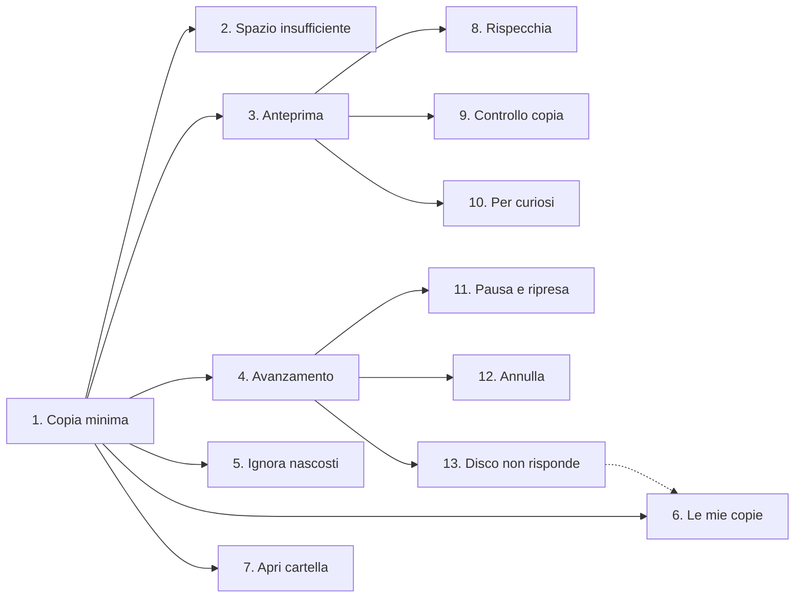

# Backup Foto – fette verticali

Il prototipo (`prototipo/index.html`) diviso in fette verticali: ognuna attraversa
interfaccia → logica → `rsync` reale ed è rilasciabile e provabile da sola.
Le fette sono raggruppate per livello di dipendenza: un livello si può iniziare quando le fette
da cui dipende sono pronte; dentro lo stesso livello le fette sono indipendenti tra loro.

**Definizione di fatto, comune a tutte le fette:** testi in italiano semplice, nessun comando
visibile fuori da «Per curiosi», usabile da tastiera, focus sul titolo a ogni cambio schermata,
annunci per lettori di schermo, layout corretto a 360 px.

La freccia tratteggiata è una dipendenza debole: «Le mie copie» funziona anche senza la 13,
ma l'esito «Da riprendere» compare solo quando c'è la gestione dell'errore.

## Squadra di 5

Tre ondate: una ondata parte quando le fette da cui dipende sono pronte.
Ognuno prosegue sulla parte che ha costruito, così le fette che toccano la stessa schermata
restano nelle stesse mani.

| Persona | Ondata 1 | Ondata 2 | Ondata 3 |
|---|---|---|---|
| A | 1. Copia minima (guida, tutti insieme) | 3. Anteprima | 8. Rispecchia |
| B | ↑ con A | 4. Avanzamento | 11. Pausa e ripresa + 12. Annulla (stessi controlli) |
| C | ↑ con A | 6. Le mie copie | 13. Disco non risponde (completa «Da riprendere» della 6) |
| D | ↑ con A | 2. Spazio insufficiente | 9. Controllo copia |
| E | ↑ con A | 5. Ignora nascosti + 7. Apri cartella (piccole) | 10. Per curiosi |

- **Ondata 1:** la 1 fissa la struttura (interfaccia, chiamata a `rsync`, lettura dell'esito)
  su cui poggia tutto il resto: conviene farla in gruppo, con A alla tastiera.
- **Punti di contatto:** 8, 9 e 5 aggiungono opzioni allo stesso comando `rsync` e al passo 3:
  A, D ed E concordano la forma delle opzioni prima di iniziare. 10 mostra quel comando: E lo fa per ultima.

---

## Livello 0 – base

Da fare per prima: tutte le altre partono da qui.

### 1. Copia minima: da dove, dove, copia
Tag: `rsync-ui`

Come fotografo voglio scegliere da dove e dove copiare e avviare la copia, così ho un backup delle foto nuove.

- Schermate: «Da dove?» (passo 1), «Dove le salvo?» (passo 2), avvio, «Le tue foto sono al sicuro».
- `rsync -a "<sorgente>" "<destinazione>"`
- «Avanti» disabilitato finché non c'è una scelta; «Annulla» torna all'inizio.
- La schermata finale mostra foto nuove, aggiornate e GB copiati.

Dipende da: —

## Livello 1 – dipendono solo dalla copia minima

Indipendenti tra loro: si possono fare in parallelo.

### 2. Spazio insufficiente sulla destinazione
Tag: `rsync-ui`

Come fotografo voglio sapere prima di iniziare se il disco è troppo pieno, così nessuna foto resta a metà.

- Se lo spazio libero è minore dei GB da copiare: avviso «Qui non c'è abbastanza spazio» con GB necessari e disponibili.
- «Avanti» resta disabilitato finché non scelgo un altro posto.
- Le schede mostrano lo spazio libero e la barra di occupazione.

Dipende da: 1

### 3. Anteprima prima di copiare
Tag: `rsync-ui`

Come fotografo voglio vedere cosa succederà prima di copiare, così non ho sorprese.

- Schermata «Controlla prima di copiare» (passo 4): sorgente → destinazione, foto nuove, aggiornate, GB, tempo stimato.
- `rsync -a -n` (prova senza copiare niente).
- «Vedi l'elenco delle foto»: elenco richiudibile con etichetta Nuova / Aggiornata.
- «Copia ora» avvia la copia vera.

Dipende da: 1

### 4. Avanzamento in tempo reale
Tag: `rsync-ui`

Come fotografo voglio vedere quanto manca, così so se posso allontanarmi.

- Percentuale grande, barra di avanzamento, foto in copia, foto copiate «N di M», velocità, tempo rimasto.
- `--info=progress2`
- Annuncio per lettori di schermo ogni 25%; a 100% passa da solo alla schermata finale.

Dipende da: 1

### 5. Ignora i file di sistema nascosti
Tag: `rsync-ui`

Come fotografo non voglio file che non sono foto nel backup.

- Interruttore «Ignora i file di sistema nascosti», acceso di default.
- `--exclude='.DS_Store' --exclude='Thumbs.db'`

Dipende da: 1

### 6. Le mie copie: salva e riavvia
Tag: `rsync-ui`

Come fotografo voglio salvare una copia e rifarla con un clic, così non ripeto le scelte ogni volta.

- Schermata finale: campo «Salva questa copia per la prossima volta» con nome proposto «Sorgente → Destinazione»; nome vuoto = errore.
- Home «Le mie copie»: nome, ultima copia, esito («Tutto al sicuro» / «Da riprendere»), «Avvia», «Nuova copia».
- «Avvia» usa le scelte salvate e parte subito; le copie salvate restano dopo il riavvio dell'app.

Dipende da: 1 (gli esiti «Da riprendere» arrivano con la 13)

### 7. Apri la cartella di backup
Tag: `rsync-ui`

Come fotografo voglio aprire la cartella del backup a copia finita, così controllo le foto.

- «Apri la cartella di backup» apre la destinazione nel gestore file del sistema.

Dipende da: 1

## Livello 2a – costruite sull'anteprima

Richiedono la fetta 3.

### 8. Rispecchia esattamente la sorgente
Tag: `rsync-ui`

Come fotografo voglio che il backup diventi identico alla sorgente, così non tengo foto che ho scartato.

- Passo 3 «Come vuoi copiare?»: «Copia solo le foto nuove (consigliato)» predefinita, oppure «Rispecchia».
- Scegliendo «Rispecchia» serve la conferma esplicita, altrimenti «Avanti» è disabilitato.
- Anteprima: conteggio «da eliminare» in evidenza ed elenco delle foto che verranno cancellate.
- `--delete`

Dipende da: 3

### 9. Controllo che ogni copia sia perfetta
Tag: `rsync-ui`

Come fotografo voglio verificare ogni foto copiata, così sono sicuro che il backup è integro.

- Interruttore «Controlla che ogni copia sia perfetta (più lento)», spento di default.
- Il tempo stimato in anteprima aumenta.
- `-c`

Dipende da: 3

### 10. Per curiosi: vedi il comando
Tag: `rsync-ui`

Come persona che vuole imparare voglio vedere il comando `rsync` corrispondente alle mie scelte.

- Sezione richiudibile in anteprima (comando con `-n`) e nella schermata finale (senza `-n`).
- Il comando riflette tutte le opzioni scelte.

Dipende da: 3

## Livello 2b – costruite sull'avanzamento

Richiedono la fetta 4.

### 11. Pausa e ripresa
Tag: `rsync-ui`

Come fotografo voglio mettere in pausa la copia e riprenderla, così posso usare il disco per altro.

- «Pausa» / «Riprendi»; titolo «Copia in pausa» e avviso «Non perdi niente».
- La ripresa non ricopia le foto già copiate.

Dipende da: 4

### 12. Annulla con conferma
Tag: `rsync-ui`

Come fotografo voglio poter fermare la copia senza paura, così non perdo quello che è già copiato.

- «Annulla» apre il dialogo «Vuoi fermare la copia?» con «Continua a copiare» (focus iniziale) e «Sì, ferma la copia».
- Confermando torno alla home con l'avviso «Copia fermata. Le foto già copiate sono al sicuro.»

Dipende da: 4

### 13. Disco che non risponde
Tag: `rsync-ui`

Come fotografo voglio capire cosa fare se il disco si scollega, così non penso di aver perso le foto.

- Errore di `rsync` sulla destinazione → schermata «Il disco di backup non risponde» con rassicurazione.
- «Riprova» riparte senza ricopiare le foto già copiate; «Torna alle mie copie».
- L'ultima copia viene segnata «Da riprendere».

Dipende da: 4
